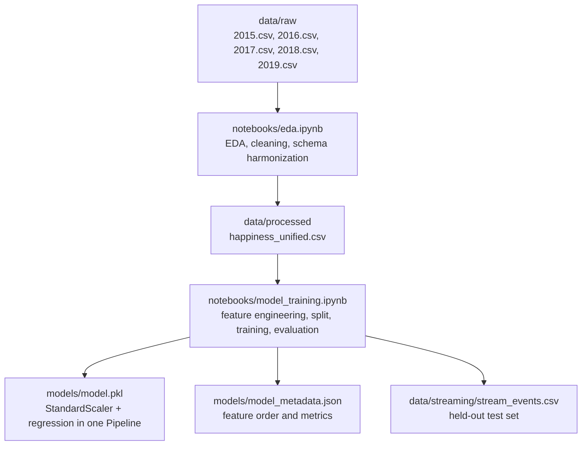
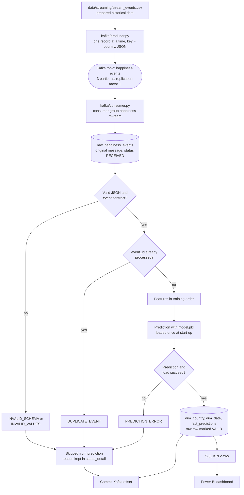
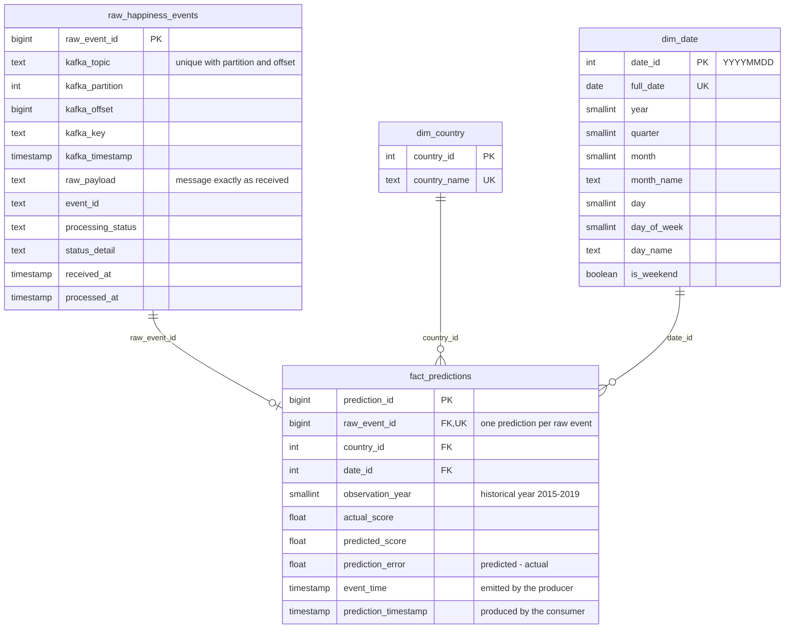
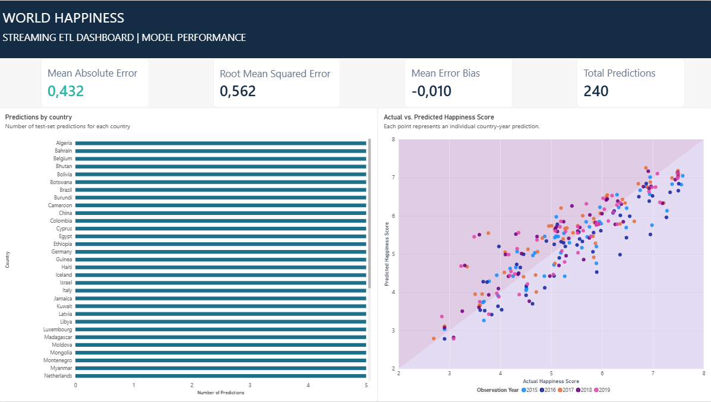
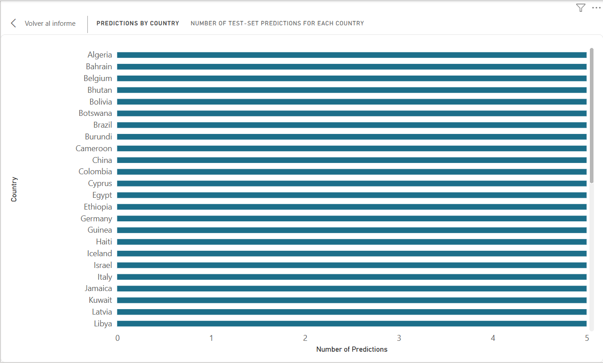
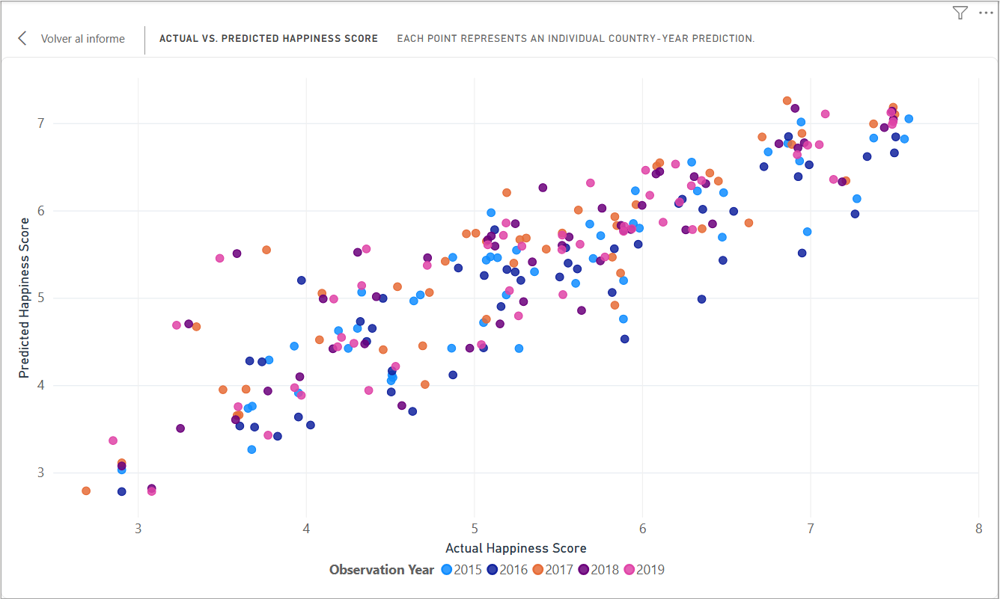
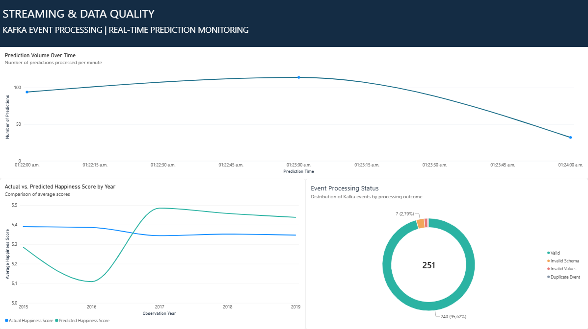
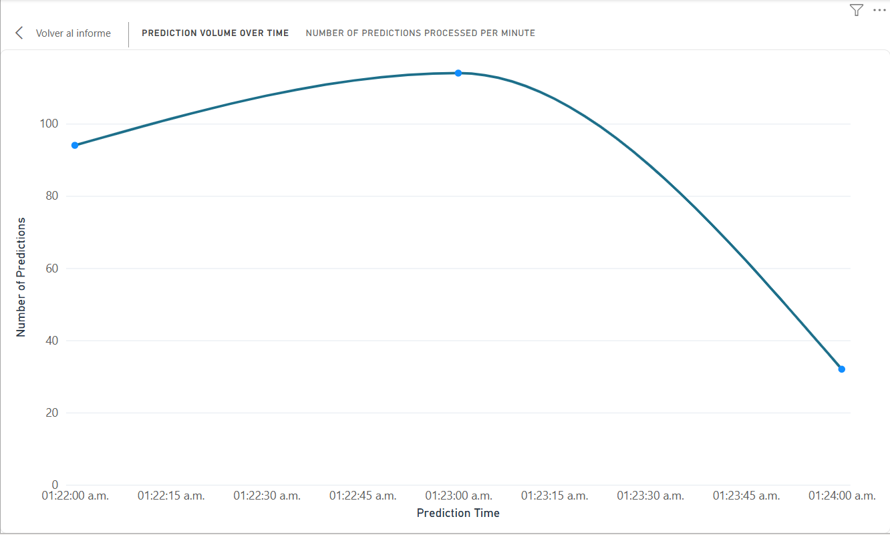
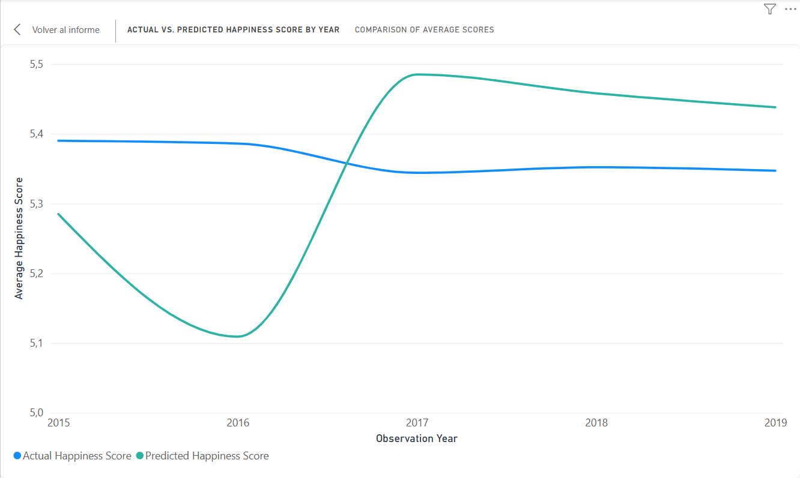
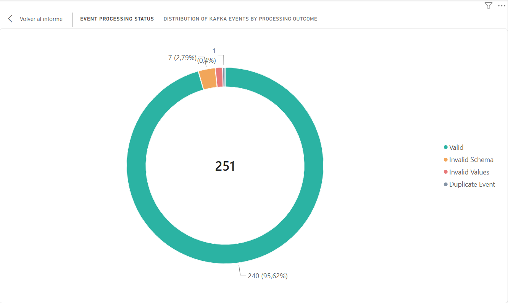

# Workshop 3. Streaming ETL with Apache Kafka and Machine Learning

**Streaming:** Apache Kafka 4.4.0 (Docker, confluent-kafka Python client)  
**Database:** PostgreSQL 16  
**Machine learning:** Pandas and scikit-learn (preprocessing and model in one serialized Pipeline)  
**Analytics:** PostgreSQL KPI views and Power BI

This repository turns a classic batch ETL into an event-driven streaming pipeline that produces real-time predictions. The files are harmonized and used to train a simple regression model. A Kafka producer then replays historical records as events, and a Kafka consumer stores each raw event, validates it against an explicit event contract, predicts the happiness score with the serialized model and loads the result into PostgreSQL.

## Contents

1. [Project description](#1-project-description)
2. [Architecture](#2-architecture)
3. [Data cleaning decisions](#3-data-cleaning-decisions)
4. [Feature engineering decisions](#4-feature-engineering-decisions)
5. [Kafka pipeline and event contract](#5-kafka-pipeline-and-event-contract)
6. [Database schema](#6-database-schema)
7. [Dashboard explanation](#7-dashboard-explanation)
8. [Execution instructions](#8-execution-instructions)
9. [Troubleshooting](#9-troubleshooting)
10. [Assumptions](#10-assumptions)
11. [Repository structure](#11-repository-structure)

---

## 1. Project description

This project turns a classic batch ETL into an event-driven streaming pipeline that produces real-time predictions.

1. **Offline (batch) part.** The five files, which do not share the same schema, are profiled, cleaned and harmonized into one unified dataset. A simple regression model that predicts the happiness score from six factors is trained, evaluated and serialized (together with its preprocessing) in `models/model.pkl`.
2. **Streaming part.** A Kafka producer replays historical records one by one as events. A Kafka consumer stores every raw event, validates it against an explicit event contract, applies the same preprocessing used in training, predicts the happiness score and stores the result in PostgreSQL.
3. **Analytics part.** The predictions are modelled as a small star schema (`fact_predictions`, `dim_country`, `dim_date`) and a dashboard reads the database to provide organized analytic information to be interpreted.

---

## 2. Architecture

### Offline process (batch)

The offline part prepares the data and produces the artifacts that the streaming part needs.



### Streaming process

The producer reads the prepared historical data, not the raw files. Every message goes through the same path in the consumer, and every path ends by committing the Kafka offset.



### Component responsibilities

| Component | Responsibility |
|---|---|
| Kafka | Transports and retains events (partitions, offsets, consumer group). It does not know what an event means. |
| `kafka/producer.py` | Reads the prepared records one by one, builds the JSON event, sets `event_time` at emission and publishes it with `country` as the key. |
| `kafka/contract.py` | The event contract and its validation: the single source of truth shared by documentation, tests and consumer. |
| `kafka/consumer.py` | Owns raw storage, validation, preprocessing, inference and persistence. |
| `kafka/db.py` | PostgreSQL access layer: raw insert, status updates, dimensions and fact load in one transaction. |
| `kafka/config.py`, `kafka/kafka_utils.py` | Shared settings, and a helper that creates the topic with the required layout when it does not exist. |
| PostgreSQL | Persists the trusted result (facts and dimensions) and the evidence of every message that arrived (raw table). |
| `models/model.pkl` | Preprocessing and model in one object, so training and serving cannot drift apart. |
| `models/model_metadata.json` | Feature names in training order, used by the consumer to build the model input and to validate the model. |
| `sql/kpis.sql` | Views that feed the dashboard. |

---

## 3. Data cleaning decisions

Full evidence and code are in `notebooks/eda.ipynb`. The raw files have these data quality problems and decisions:

| Problem found | Decision | Why |
|---|---|---|
| Three naming conventions for the same variables (four column layouts in total); 2017 also changes the column order | Explicit per-year rename dictionary, selecting columns by name | Concatenating by position would silently swap `generosity` and `corruption` in 2017 |
| `Region`, standard error, confidence intervals, whiskers and `Dystopia Residual` exist only in some years | Keep only the columns common to all five years | A model and an event contract can only rely on fields that always exist |
| `Dystopia Residual` and `Happiness Rank` are derived from the target | Excluded from modelling | Target leakage (score = six factors + dystopia residual, verified to 0.0005) |
| 6 country-name variants (`Hong Kong S.A.R., China`, `Taiwan Province of China`, `Trinidad & Tobago`, `Northern Cyprus`, `Macedonia`, `Somaliland region`) | Explicit mapping, checked so that a variant and its canonical name never coexist in the same year | 170 raw names become 164 real countries, fuzzy matching could merge different countries |
| 1 missing value: `corruption` of United Arab Emirates 2018 | Mean of the same country's 2017 and 2019 values | Keeps the record, uses only dataset values, and that country's series is smooth |
| 2017 stores 14-15 decimals of floating-point noise | Round every factor and the score to 5 decimals | Same precision in every year |
| Countries missing in some years | Not filled | Their absence is real survey coverage, inventing rows would create fake observations |

**Result:** `data/processed/happiness_unified.csv`, 782 rows, 164 countries (146 present in all five years), no nulls, unique (`country`, `year`). The notebook ends with assertions that verify these properties.

---

## 4. Feature engineering decisions

Full detail in `notebooks/model_training.ipynb`.

- **Features:** `gdp`, `family`, `health`, `freedom`, `generosity`, `corruption`. They exist in every year and are exactly the numeric fields carried by the streaming event, so the consumer can always build the model input. Correlation with the score: `gdp` 0.79, `health` 0.74, `family` 0.65, `freedom` 0.55, `corruption` 0.40, `generosity` 0.14.
- **Target:** `happiness_score` (`actual_happiness_score` in the event). It is never a model input: in streaming it is only used afterwards to compute the prediction error.
- **Excluded:** `happiness_rank` (leakage), `country` (an identifier with 164 values; the model would memorize countries), `year` (no signal: the yearly mean score is flat), `event_id` (identifier).
- **Categorical data:** none after the selection, so no encoding is needed.
- **Scaling:** `StandardScaler` inside the Pipeline, so the exact training statistics are serialized with the model.
- **Split:** approximately 69 % / 31 %, grouped by country (542 / 240 rows = 69 % / 31 %, 0 shared countries; whole countries move together, so the ratio is approximate). A country appears in up to five years with similar values; a plain random split would leak it into the test set.
- **Model selection:** decided before looking at the test set, by 5-fold grouped cross-validation on the training set. Linear Regression won (CV RMSE 0.567) against Decision Tree (0.668) and Random Forest (0.589), and it is the simplest.

---

## 5. Kafka pipeline and event contract

### Topic and clients

| Item | Value |
|---|---|
| Topic | `happiness-events`: 3 partitions, replication factor 1 (single local broker) |
| Event key | `country` (events of the same country go to the same partition, preserving their order) |
| Value | JSON |
| Consumer group | `happiness-ml-team` |
| Offset handling | `enable.auto.commit = false`; the offset is committed **after** the database work |
| Topic creation | Done by `producer.py` / `consumer.py` if missing, so the 3-partition design is never replaced by a broker default of 1 partition |

### Producer (`kafka/producer.py`)

Reads the prepared historical data record by record, builds the event, sets `event_time` to the moment of emission and publishes it, waiting a configurable delay between records (0.5 s). The CSV is a bounded source, the delay only simulates data arriving over time.

**Controlled invalid messages:** The cleaned data satisfy the contract in every row, so a normal run never exercises the validation. The option `--inject-invalid` mixes 11 deliberately wrong messages into the stream (missing field, text instead of a number, negative value, empty country, bad timestamp, year as text, null feature, score out of range, NaN, malformed JSON, and a repeated `event_id`). Their `event_id`s start with `BAD`, they are off by default, and they never reach `fact_predictions`, so the KPIs are identical with or without them. They exist only to demonstrate that invalid records are stored, skipped and never stop the pipeline.

### Event contract

Defined in `kafka/contract.py` before the consumer logic, because Kafka transports the record but the application is responsible for validating the business fields.

```json
{
  "event_id": "E001", "country": "Colombia", "year": 2019,
  "gdp": 1.2, "family": 0.8, "health": 0.9, "freedom": 0.6,
  "generosity": 0.3, "corruption": 0.1,
  "actual_happiness_score": 6.2,
  "event_time": "2026-10-30T15:30:00"
}
```

| Field | Type | Rule |
|---|---|---|
| `event_id` | string | Required, non-empty; unique among accepted events |
| `country` | string | Required, non-empty; also the Kafka key |
| `year` | integer | Required, historical observation year, 2015-2019 |
| `gdp`, `family`, `health`, `freedom`, `generosity`, `corruption` | number | Required, finite |
| `actual_happiness_score` | number | Required, finite, between 0 and 10. Used only for evaluation, never as a model input |
| `event_time` | string | Required, ISO-8601 timestamp: when the producer emitted the event |

### Consumer (`kafka/consumer.py`)

The model and its metadata are loaded once at start-up, and the consumer refuses to start if the feature order stored in `model.pkl` differs from the metadata. For every message, in this order:

1. Store the original message in `raw_happiness_events` (exact text, topic, partition, offset, key) with status `RECEIVED`, before any validation or prediction.
2. Parse the JSON.
3. Validate the contract (required fields, missing fields, wrong types, invalid numeric values, features required by the model).
4. Reject duplicates (`event_id` already processed successfully).
5. Build the feature row in the training order read from `models/model_metadata.json`.
6. Predict with the serialized Pipeline.
7. Store dimensions, the fact row and the final status in one transaction.
8. Commit the Kafka offset.

| Status in the raw table | Meaning |
|---|---|
| `RECEIVED` | Initial state, set when the raw message is stored |
| `VALID` | Passed the contract and was predicted; a row exists in `fact_predictions` |
| `INVALID_SCHEMA` | Not JSON / not an object, missing or null field, wrong type, empty string, bad timestamp, a model feature missing |
| `INVALID_VALUES` | Right structure but impossible values: NaN, infinity, negative or out of range |
| `PREDICTION_ERROR` | Contract passed, but the model or the load step failed for this event |
| `DUPLICATE_EVENT` | A `VALID` event with the same `event_id` was already processed |

Invalid events are stored in the raw table, skipped from prediction and never stop the pipeline, the reason is kept in `status_detail`.

**Reliability behaviours implemented**

- A redelivered Kafka message (same topic, partition and offset, for example after a crash before the offset commit) is recognized by a unique constraint and not processed twice. The console reports it as `SKIPPED_REDELIVERED` (this label exists only in the console, not in the database).
- If the database is down, the consumer retries with back-off and, if it stays down, stops without committing the offset, so no event is skipped.

---

## 6. Database schema

Created by `sql/create_tables.sql` in PostgreSQL. The raw table is a staging and audit table, not a dimension.



- Traceability: every prediction links to the exact Kafka message through `raw_event_id` (and from there to partition and offset).
- `dim_date` is the calendar day of `event_time`; `observation_year` is kept in the fact table so trends over the historical years are meaningful. All timestamps are naive local time created by Python, the same convention as the producer.
- The raw payload is stored as `TEXT` on purpose: it preserves the message exactly as it arrived, including malformed JSON.
- `fact_predictions` holds one row per event that was validated and predicted successfully, rejected events exist only in the raw table.

---

## 7. Dashboard explanation

The dashboard imports its data from the PostgreSQL views of `sql/kpis.sql`. It is a snapshot of the database: after running the pipeline.

| KPI | View | Visual | How to read it |
|---|---|---|---|
| 1. Average prediction error | `vw_kpi_average_error` | KPI cards: MAE, RMSE, Mean Error Bias, and Total predictions | Measures the magnitude and direction of prediction errors in happiness-score points. A positive bias indicates over-prediction and a negative bias indicates under-prediction, and displays the total number of successfully stored predictions. |
| 2. Predictions by country | `vw_kpi_predictions_by_country` | Horizontal bar chart | Shows the number of test-set predictions for each country, also providing country-level MAE and average actual and predicted scores as tooltips. |
| 3. Predicted vs actual score | `vw_kpi_predicted_vs_actual` | Scatter plot | Each point represents an individual country-year prediction. Points closer to the reference diagonal indicate more accurate predictions. |
| 4. Prediction trends over time | `vw_kpi_trend_by_year`, `vw_kpi_trend_by_time` | Two line charts | The first chat compares average actual and predicted scores by historical observation year, and the second chart shows the number of predictions processed per minute during streaming. |
| 5. Distribution of event proccessing status | `vw_event_quality` | Donut chart | Shows the distribution of incoming raw events by processing status, including valid, invalid, and duplicate events. |

**KPI explanations**

- Mean Absolute Error (MAE): measures the average absolute difference between predicted and actual happiness scores, expressed in score points.

- Root Mean Squared Error (RMSE): measures the square root of the average squared prediction errors. Unlike MAE, it gives greater weight to larger prediction mistakes.

- Mean Error Bias: represents the average of predicted_score - actual_score. A positive value indicates that the model tends to over-predict, while a negative value indicates under-prediction. A value close to zero indicates little systematic bias.

- Predictions by Country: counts the successfully processed predictions for each country. Since the test set contains historical observations from 2015 to 2019, each country can contribute up to five predictions. Some countries have fewer observations because they are not present in every yearly dataset.

- Actual vs. Predicted Happiness Score: compares the actual happiness score against the model's predicted score for each individual observation. The distance from the reference diagonal indicates the prediction error.

- Prediction Trends: provides two temporal perspectives. The yearly chart compares average actual and predicted happiness scores across historical observation years (2015–2019), while the streaming chart groups predictions by processing minute.

- Event Processing Status: monitors the quality of incoming Kafka events stored in raw_happiness_events. The chart distinguishes and counts the quantity of processed, rejected and duplicate events(VALID, INVALID_SCHEMA, INVALID_VALUES, DUPLICATE_EVENT, and PREDICTION_ERROR, when present).

**Dashboard files**

- Power BI file: `dashboards/happiness_dashboard.pbix`
- Screenshots: `dashboards/screenshots/`

















---

## 8. Execution instructions

Commands are written for Windows 11 + Docker Desktop + PowerShell and Python 3.12. Run every command from the project root.

### 1. Python environment

```powershell
python -m venv .venv
.\.venv\Scripts\Activate.ps1
python -m pip install -r requirements.txt
```

### 2. Offline process (already executed; re-run only to regenerate)

Open and press Run All, in this order, `notebooks/eda.ipynb` and then `notebooks/model_training.ipynb` (while being inside the virtual environment, kernel = the `.venv`). They write `data/processed/`, `data/streaming/` and `models/`.

### 3. Start Kafka and PostgreSQL

```powershell
docker compose up -d
docker compose ps
```

### 4. Run the streaming pipeline (two terminals, both with the virtual environment active)

```powershell
# Terminal 1 - consumer (stays running; Ctrl+C to stop)
python kafka\consumer.py

# Terminal 2 - producer: 240 valid events + 11 deliberately invalid ones
python kafka\producer.py --inject-invalid
```

### 5. Inspect Kafka and the database

```powershell
# topic layout
docker compose exec kafka /opt/kafka/bin/kafka-topics.sh --describe --topic happiness-events --bootstrap-server localhost:9092

# consumer group position and lag
docker compose exec kafka /opt/kafka/bin/kafka-consumer-groups.sh --bootstrap-server localhost:9092 --describe --group happiness-ml-team

# events by processing status, and the KPI
docker compose exec postgres psql -P pager=off -U happiness -d happiness_db -c "SELECT * FROM vw_event_quality;"

docker compose exec postgres psql -P pager=off -U happiness -d happiness_db -c "SELECT * FROM vw_kpi_average_error;"

# rejected events and why
docker compose exec postgres psql -P pager=off -U happiness -d happiness_db -c "SELECT event_id, processing_status, status_detail FROM raw_happiness_events WHERE processing_status NOT IN ('VALID','RECEIVED') ORDER BY raw_event_id;"

# raw storage: original message, partition, offset and status
docker compose exec postgres psql -P pager=off -U happiness -d happiness_db -c "SELECT raw_event_id, kafka_partition, kafka_offset, kafka_key, processing_status, LEFT(raw_payload, 70) AS payload FROM raw_happiness_events ORDER BY raw_event_id LIMIT 5;"

# traceability: each prediction linked to its raw event
docker compose exec postgres psql -P pager=off -U happiness -d happiness_db -c "SELECT f.prediction_id, f.raw_event_id, r.event_id, f.actual_score, f.predicted_score, f.prediction_error FROM fact_predictions f JOIN raw_happiness_events r USING (raw_event_id) LIMIT 5;"

# consistency: VALID raw events = fact rows
docker compose exec postgres psql -P pager=off -U happiness -d happiness_db -c "SELECT (SELECT COUNT(*) FROM raw_happiness_events WHERE processing_status='VALID') AS raw_valid, (SELECT COUNT(*) FROM fact_predictions) AS fact_rows;"

# key routing: keys found in more than one partition
docker compose exec postgres psql -P pager=off -U happiness -d happiness_db -c "SELECT kafka_key FROM raw_happiness_events GROUP BY kafka_key HAVING COUNT(DISTINCT kafka_partition) > 1;"

# key routing: events per partition 
docker compose exec postgres psql -P pager=off -U happiness -d happiness_db -c "SELECT kafka_partition, COUNT(DISTINCT kafka_key) AS keys, COUNT(*) AS events FROM raw_happiness_events GROUP BY kafka_partition ORDER BY kafka_partition;"
```

### 6. Tests

```powershell
python -m unittest discover -s tests -v
```

### Stop and reset

```powershell
docker compose down        # Stops containers
docker compose down -v     # Delete volumes
```

Re-running the producer while the containers are still running: the new messages get new offsets, and the repeated `event_id`s are stored as `DUPLICATE_EVENT` without creating new predictions.

---

## 9. Troubleshooting

| Symptom | Likely cause / fix |
|---|---|
| `Kafka is not reachable at localhost:9092` | Container not running yet: `docker compose ps`, then wait a few seconds |
| `Topic 'happiness-events' exists with 1 partitions but 3 are required` | The topic was auto-created by another client. `docker compose down -v` and start again |
| Every message is reported as `SKIPPED_REDELIVERED` | Kafka was reset but PostgreSQL kept its data. `docker compose down -v` and start again |
| The `kafka` container exits right after starting | Read `docker compose logs kafka`. If the cause is an old or incompatible `kafka_data` volume, `docker compose down -v` and start again |
| `Waiting for PostgreSQL...` for a long time | `docker compose logs postgres`; port 5432 may already be used by a local PostgreSQL (change the host port in the compose file and set `POSTGRES_PORT`) |
| `models/model.pkl ... not found` | Run `notebooks/model_training.ipynb` first |
| Error unpickling `model.pkl` | The scikit-learn version differs from `requirements.txt`; reinstall the pinned versions |
| `psql` output stays on `(END)` | `psql` opened its pager; press `q` the commands above already use `-P pager=off` |
| Connection settings | Override with env vars: `KAFKA_BOOTSTRAP_SERVERS`, `POSTGRES_HOST`, `POSTGRES_PORT`, `POSTGRES_DB`, `POSTGRES_USER`, `POSTGRES_PASSWORD` (there is no need to change the credentials in the compose file) |

---

## 10. Assumptions

- The numeric ranges of the event contract (factors 0-3, score 0-10, year 2015-2019), the grouped-by-country split, the imputation of the single missing value and the rounding to 5 decimals are decisions justified by data observation.
- `RECEIVED` and `DUPLICATE_EVENT` are added to the four suggested processing statuses; `models/model_metadata.json` and the extra modules of `kafka/` are added to the recommended folder structure.
- The controlled invalid messages of `--inject-invalid` and the `tests/` folder are verification aids, the pipeline does not depend on them.
- `dim_date` is the calendar day of `event_time`, and `observation_year` is stored in the fact table to give the time trend its historical meaning.

---

## 11. Repository structure

```text
├── data/
│   ├── raw/                                    # original files, never modified
│   │   ├── 2015.csv
│   │   ├── 2016.csv
│   │   ├── 2017.csv
│   │   ├── 2018.csv                            
│   │   └── 2019.csv
│   ├── processed/
│   │   └── happiness_unified.csv
│   └── streaming/
│       ├── stream_events.csv             # held-out test set (default source of the producer)
│       └── stream_events_full.csv        # every historical row
├── notebooks/
│   ├── eda.ipynb
│   └── model_training.ipynb
├── kafka/
│   ├── producer.py
│   ├── consumer.py
│   ├── contract.py
│   ├── db.py
│   ├── config.py
│   └── kafka_utils.py
├── models/
│   ├── model.pkl
│   └── model_metadata.json
├── sql/
│   ├── create_tables.sql
│   └── kpis.sql
├── dashboards/                           # Power BI file, and screenshots
│   ├── README.md
│   └── screenshots/
├── tests/
│   ├── _setup.py
│   ├── test_contract.py
│   ├── test_producer.py
│   └── test_consumer_pipeline.py
├── docker-compose.yml
├── requirements.txt
├── .gitignore
└── README.md
```
